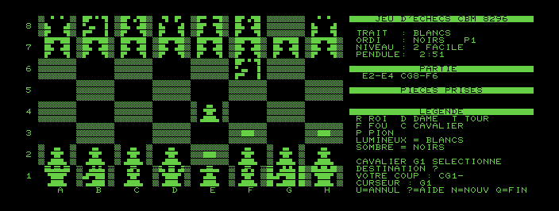
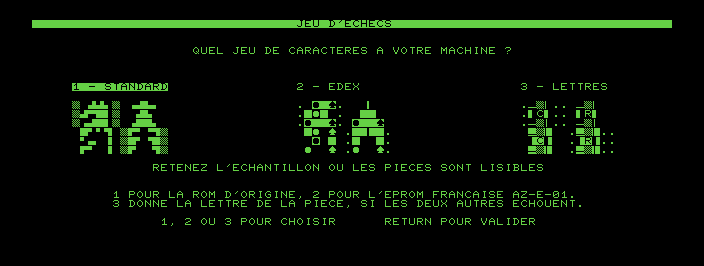

# Jeu d'échecs pour Commodore 8296

Un jeu d'échecs entièrement écrit en assembleur 6502 pour un **Commodore 8296**,
avec de grandes pièces dessinées en quarts de bloc PETSCII et un échiquier plein
écran sur l'affichage 80×25. Aucune modification matérielle : le programme tourne
sur la machine telle quelle.

Ce projet fait suite au [jeu de dames](https://github.com/fabrice35860-web/dames-8296)
du même auteur, dont il reprend l'infrastructure (écran de choix de ROM, lecture
clavier, outils de test sous VICE).



## État

**Le jeu se joue : règles complètes et adversaire.**

L'affichage :

- écran de choix du jeu de caractères, trois échantillons côte à côte, avec
  présélection automatique par lecture de la ROM de l'éditeur ;
- échiquier plein écran, cases de 6×3 caractères, coordonnées A–H et 1–8 ;
- les six pièces dessinées, blanches en silhouette lumineuse, noires en
  silhouette sombre dans un rectangle allumé — en quarts de bloc sur ROM
  standard, en triangles d'angle sur l'EPROM française ;
- panneau d'informations : trait, camp de l'ordinateur et profondeur atteinte,
  niveau, pendule, derniers coups, pièces prises, légende, messages, saisie ;
- curseur qui fait battre toute la case, pièce choisie marquée par deux barres,
  destinations légales marquées d'un bloc au centre, prises possibles qui battent ;
- déplacement des pièces au curseur **ou** en notation (`E2-E4`, `CG1-F3`, `O-O`).

Les règles (FIDE, complètes) :

- les six pièces, le roque, la prise en passant, la promotion au choix ;
- un coup qui laisse son roi en échec est refusé ;
- échec, mat, pat, règle des 50 coups, matériel insuffisant, triple répétition ;
- retour en arrière sur toute la partie (touche `U`).

Le générateur de coups est validé par **perft** : dix-sept valeurs de référence
sur cinq positions, sans aucun écart (position initiale jusqu'à 197 281 nœuds,
Kiwipete, finale de pions, position à promotions, position encombrée).

L'adversaire :

- alpha-bêta négamax avec recherche de calme, pour ne pas s'arrêter en plein
  échange de pièces ;
- approfondissement itératif borné par le temps du niveau, le meilleur coup de
  l'itération précédente étant essayé en premier ;
- tri des coups MVV-LVA : on essaie d'abord de prendre la grosse pièce avec la
  petite, ce qui fait couper bien plus tôt ;
- évaluation matérielle et positionnelle, structure de pions simple, roi qui se
  cache au milieu de partie et sort en finale ;
- six niveaux, de l'instantané à trois minutes par coup ; `STOP` fait jouer
  l'ordinateur tout de suite.

Comptez environ 36 000 cycles par position examinée, soit une trentaine par
seconde sur la vraie machine : c'est le rythme d'un 6502 à 1 MHz.

Restent à faire : la table de transpositions et la bibliothèque d'ouvertures en
RAM étendue, qui attendent que la commutation par `$FFF0` soit vérifiée sur la
machine réelle.

## Les touches

| Touche | Effet |
|---|---|
| flèches, pavé `8 2 4 6` | déplacer le curseur |
| pavé `7 9 1 3` | déplacer en diagonale |
| RETURN, ESPACE | choisir une pièce, puis jouer |
| lettre ou chiffre | saisie en notation (`E2-E4`, `CG1-F3`) |
| DEL | effacer un caractère de la saisie |
| `U` | annuler le dernier coup |
| `J` | camp tenu par l'ordinateur : aucun, les Noirs, les Blancs |
| `L` | changer de niveau |
| `STOP` | faire jouer l'ordinateur tout de suite |
| `N` | nouvelle partie |
| `M` | revenir au choix du jeu de caractères |
| `?` | aide |
| `Q` | quitter |

## Construire et lancer

```
sudo apt install vice 64tass
64tass --cbm-prg -o echecs.prg main.asm
xpet -model 8296 -autostart echecs.prg
```

Sur la machine réelle : `LOAD"ECHECS",8` puis `RUN`.

Les tables précalculées sont produites par des scripts Python ; il faut les
relancer après avoir modifié un dessin de pièce ou la géométrie de l'écran :

```
python3 outils/generer_pieces.py     # -> donnees_pieces.asm
python3 outils/generer_tables.py     # -> donnees_tables.asm
python3 outils/generer_eval.py       # -> donnees_eval.asm
python3 outils/generer_perft.py      # -> donnees_perft.asm
python3 outils/generer_ia.py         # -> donnees_ia.asm
```

Deux programmes de validation s'assemblent à part. Ils reprennent du jeu le
moteur seul — générateur de coups, évaluation, recherche — sans rien de
l'affichage :

```
64tass --cbm-prg -o perft.prg perft.asm
64tass --cbm-prg -o test_ia.prg test_ia.asm
```

## Tester

`outils/test_affichage.py` lance le jeu dans VICE pour une cinquantaine de
scénarios, relit l'écran produit et vérifie ce qui s'y trouve. La lecture de
l'écran se fait en comparant chaque cellule de la capture aux 256 glyphes du
générateur de caractères : on retrouve ainsi exactement les codes écrits par le
programme.

```
python3 outils/test_affichage.py          # tous les scénarios
python3 outils/test_affichage.py curseur  # ceux dont le nom contient "curseur"
python3 outils/test_affichage.py -v       # avec le contenu de l'écran
```

`outils/test_perft.py` lance `perft.prg` et compte les positions atteintes à
chaque profondeur sur cinq positions de référence, puis compare aux valeurs que
python-chess calcule de son côté. C'est le juge du générateur de coups : roque,
prise en passant, promotion et clouages y passent tous. Comptez une à deux
minutes.

`outils/test_ia.py` lance `test_ia.prg` sur six positions où le bon coup ne fait
aucun doute — un mat en un, une reprise, une dame à sauver, un pion franc à
prendre, une promotion — et vérifie ce que l'adversaire choisit. Un échec vient
de la recherche ou de l'évaluation, jamais du générateur de coups.

```
pip install python-chess --break-system-packages
python3 outils/test_perft.py
python3 outils/test_ia.py
```

`outils/verifier_textes.py` vérifie qu'aucun message du panneau ne dépasse ses
28 colonnes : au-delà, le texte ne se tronque pas, il continue sur la ligne
suivante colonne 0, par-dessus l'échiquier. Ce contrôle tourne aussi au début de
`test_affichage.py`.

`outils/verifier_quarts.py` lit un générateur de caractères et dit quels codes y
donnent les seize quarts de bloc. Il a servi à valider la table des pièces, et
servira à répondre pour l'EPROM française.

## Les ROM

Les ROM Commodore (KERNAL, BASIC, éditeur, générateur de caractères) sont sous
droits d'auteur : **elles ne font pas partie de ce dépôt**. VICE les installe de
son côté, généralement dans `~/.local/share/vice/PET/`. Les outils qui ont besoin
du générateur de caractères le cherchent là, ou à l'endroit indiqué par la
variable d'environnement `PET_CHARGEN`.

## Les trois jeux de caractères

La machine du propriétaire porte une EPROM française (« AZ-E-Ø1 GEN. ») et un
éditeur modifié (« EDEX 8000 ») : en mode graphique, ses codes 97 à 127 sont des
cadres et des minuscules accentuées, et **non** les quarts de bloc dont les
silhouettes sont faites. On ne peut rien y changer — le générateur de caractères
est câblé au circuit vidéo, hors de l'espace d'adressage du processeur : aucun
programme ne peut ni le lire, ni le remplacer, ni redéfinir un caractère.

Le jeu propose donc trois présentations, choisies au lancement, avec un
échantillon de chacune :

1. **STANDARD** : silhouettes en quarts de bloc, cases claires en damier `▒` ;
2. **EDEX** : les mêmes pièces redessinées avec les formes dont l'EPROM française
   dispose — quatre triangles d'angle et le bloc plein — cases claires en
   pointillé ;
3. **LETTRES** : repli, chaque pièce étant sa lettre française dans un cadre
   arrondi. Il ne demande que des traits et des coins, que toute ROM possède.



La présélection se fait toute seule : le programme calcule la somme de contrôle
de la ROM d'éditeur en `$E000` et retient STANDARD s'il la reconnaît, EDEX
sinon. Une touche suffit pour corriger, et `M` y revient en cours de partie.

### Les pièces EDEX

Les codes des quatre triangles ont été relevés sur la vraie 8296 : 81 pour le
coin haut-gauche, 65 pour le haut-droit, 209 pour le bas-droit, 193 pour le
bas-gauche — les deux derniers étant la vidéo inverse des deux premiers. Chaque
pièce est donnée par ses douze codes écran dans `outils/generer_pieces.py`, et
une pièce noire est le même dessin en vidéo inverse (`code XOR 128`), ce qui
donne la silhouette sombre dans un rectangle allumé.

**VICE ne permet pas de juger ce rendu** : il n'a que la ROM standard, où ces
numéros désignent d'autres glyphes. Ce que les tests vérifient — et c'est ce qui
peut l'être depuis un émulateur — c'est que le programme écrit les bons codes aux
bons endroits, pièces blanches, pièces noires et fond des cases compris.

## Licence

Voir [LICENSE](LICENSE). Ne jamais inclure de ROM Commodore dans ce dépôt.
